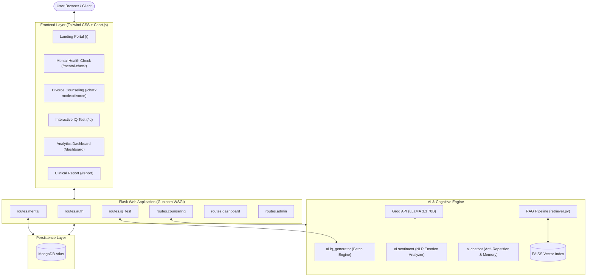

# MindSense-AI 🌿🧠⚖️
### Production-Grade Mental Health, Relationship Counseling & Adaptive Psychometric Assessment Platform

[](https://www.python.org/)
[](https://flask.palletsprojects.com/)
[](https://www.langchain.com/)
[](https://groq.com/)
[](https://github.com/facebookresearch/faiss)
[](https://www.mongodb.com/atlas)
[](https://tailwindcss.com/)
[](https://render.com/)

---

## 📌 Overview

**MindSense-AI** is a multi-mode AI psychological counseling and cognitive evaluation platform built with Flask, LangChain, FAISS, and the Groq Cloud API (LLaMA 3.3 70B). It delivers low-latency, empathetic mental health support, relationship mediation, psychometric testing, and clinical assessment reporting with strict privacy standards and anti-repetition memory guardrails.

---

## 🌟 Key Features

### 1. 🌿 Structured Mental Health Assessment
- **9-Step Clinical State Machine:** Guides users through structured depression, anxiety, sleep, and stress screening without letting open-ended rants derail the assessment.
- **Empathetic Interaction:** Gentle redirects guide users to finish the evaluation before addressing open-ended questions.
- **Automated Stratification:** Calculates stress indexes, depression indicators, and anxiety levels, generating personalized wellness regimens.

### 2. ⚖️ Divorce & Relationship Counseling
- **Conflict De-escalation & Mediation:** Context-aware guidance for individuals facing marital strain, co-parenting dilemmas, and separation grief.
- **Retrieval-Augmented Generation (RAG):** Contextual retrieval powered by **FAISS** vector search and **sentence-transformers/all-MiniLM-L6-v2** embeddings over clinical mediation literature.
- **Dynamic Word Bounds & Anti-Repetition:** SequenceMatcher comparison (60% threshold) and dynamic temperature scaling prevent robotic, repetitive bot phrases.

### 3. 🧠 Real-Time Adaptive Psychometric IQ Test
- **20-Question Dynamic Batch Generation:** Real-time generation of psychometric questions spanning Numerical Reasoning, Verbal/Alphabet Sequences, Logical Deduction, and Spatial Logic.
- **Strict Adaptive Scaling:** Questions dynamically progress from Easy (1–7), to Medium (8–14), to Hard (15–20).
- **Interactive Quiz Engine:** 30-second countdown timer per question, instant 1-second visual feedback (Green for Correct / Red for Incorrect), and weighted scoring calculating estimated IQ and percentile ranking.
- **Question Review & Explanations:** Full answer rationale and logic breakdowns rendered on the official report page.

### 4. 📊 Clinical Reports & Interactive Dashboard
- **Printable Clinical Summary:** Clean, hospital-grade PDF export formatting with print CSS stylesheets (`no-print` action bars).
- **Interactive Analytics:** 7-day emotional trends, stress & anxiety indexes, and psychological distributions visualized with Chart.js.

### 5. 🛡️ User Authentication & Admin Panel
- **Security-First Auth:** Password hashing using PBKDF2:SHA256, session management, and gender-aware counseling tuning.
- **Admin Supervision:** Real-time monitoring of user sessions, high-risk patient flags (stress $\ge 65$), and downloadable logs.

---

## 🏗️ System Architecture



---

## 🛠️ Tech Stack

| Layer | Technology | Details |
|---|---|---|
| **Backend Framework** | Python 3.11+, Flask 3.x | Modular blueprint routing, session management, Werkzeug security |
| **WSGI Server** | Gunicorn 21.x | Multi-worker HTTP production server |
| **AI / LLM Orchestration** | LangChain, LangChain-Groq | Prompt templating, memory buffers, chat orchestration |
| **LLM Inference** | Groq Cloud API | `llama-3.3-70b-versatile` running at ultra-low latency |
| **Vector Database & RAG** | FAISS (CPU), Sentence-Transformers | `all-MiniLM-L6-v2` 384-dimensional dense embeddings |
| **JSON Parser / Repair** | `json-repair` | Fault-tolerant parsing for dynamic question arrays |
| **Database** | MongoDB Atlas / PyMongo | Cloud document storage for users, sessions, and clinical reports |
| **Frontend & UI** | Tailwind CSS, FontAwesome 6, Chart.js | Fully responsive, dark/light theme persistence, animated widgets |

---

## 📂 Project Structure

```plaintext
chatbot_project/
├── app.py                      # Flask Application factory & WSGI entry point
├── config.py                   # Centralized environment & app configuration
├── requirements.txt            # Production dependencies
├── Procfile                    # Render/Heroku deployment start command
├── render.yaml                 # Render infrastructure-as-code blueprint
├── .env.example                # Sample environment template
├── .gitignore                  # Git tracking exclusion list
│
├── ai/                         # AI & Cognitive Reasoning
│   ├── chatbot.py              # Counselor agent with anti-repetition memory
│   ├── embeddings.py           # HuggingFace MiniLM embedding loader
│   ├── iq_generator.py         # Dynamic 20-question batch IQ generator
│   ├── iq_questions.py         # Fallback psychometric question bank
│   ├── prompt.py               # System prompts for counseling & assessments
│   ├── report_generator.py     # Psychological report synthesis engine
│   └── sentiment.py            # Rule-based & keyword emotion classifier
│
├── database/                   # Persistence Layer
│   └── mongodb.py              # PyMongo client, TLS handlers & queries
│
├── rag/                        # Retrieval-Augmented Generation
│   ├── loader.py               # Clinical document chunking
│   ├── retriever.py            # FAISS similarity search wrapper
│   ├── vectorstore.py          # FAISS index persistence & builder
│   └── faiss_index/            # Serialized FAISS index files
│
├── routes/                     # Modular Flask Blueprints
│   ├── admin.py                # Admin dashboard & risk monitoring
│   ├── auth.py                 # Registration & sign-in authentication
│   ├── counseling.py           # Counseling chat endpoints
│   ├── dashboard.py            # Analytics & metric aggregation
│   ├── iq_test.py              # Adaptive IQ test state machine
│   ├── mental.py               # Structured 9-step mental health check
│   └── report.py               # Printable clinical report renderer
│
├── static/                     # Assets & Client-Side Scripts
│   ├── css/style.css           # Custom styles & animations
│   └── js/
│       ├── chat.js             # Chat interface driver with typing indicator
│       ├── dashboard.js        # Chart.js visualizer
│       ├── iq_test.js          # 30s timer & answer submission logic
│       └── report.js           # Report UI utilities
│
└── templates/                  # Jinja2 HTML Templates
    ├── base.html               # Master layout with theme switcher & navbar
    ├── index.html              # Marketing & feature showcase landing page
    ├── chat.html               # Open counseling conversation interface
    ├── mental_check.html       # 9-step guided assessment UI
    ├── iq_test.html            # 20-question timed IQ quiz UI
    ├── dashboard.html          # Emotional & wellness analytics dashboard
    ├── report.html             # Printable medical-style report
    ├── login.html              # Clean authentication page
    ├── admin.html              # Administrative supervision panel
    ├── 404.html                # Friendly 404 error recovery
    └── 500.html                # Friendly 500 service unavailable screen
```

---

## 🚀 Quickstart & Local Setup

### 1. Clone Repository & Setup Virtual Environment
```bash
git clone https://github.com/your-username/mindsense-ai.git
cd mindsense-ai

# Create virtual environment
python -m venv venv

# Activate virtual environment
# Windows:
venv\Scripts\activate
# macOS/Linux:
source venv/bin/activate
```

### 2. Install Dependencies
```bash
pip install -r requirements.txt
```

### 3. Configure Environment Variables
Copy `.env.example` to `.env`:
```bash
cp .env.example .env
```
Open `.env` and fill in your credentials:
```ini
SECRET_KEY=your_generated_secret_key_here
MONGO_URI=mongodb+srv://<username>:<password>@cluster0.mongodb.net/mindsense_db?retryWrites=true&w=majority
GROQ_API_KEY=gsk_your_groq_api_key_here
GROQ_MODEL=llama-3.3-70b-versatile
```
> **Note:** If you don't have MongoDB Atlas running, the app automatically falls back to in-memory degraded mode without crashing.

### 4. Run the Development Server
```bash
python app.py
```
Open your browser at `http://127.0.0.1:5000`.

---

## ☁️ Deployment Guide (Render)

This repository is optimized for deployment on [Render](https://render.com).

### Option 1: Automatic Blueprint Deployment (Recommended)
1. Fork or push this repository to your GitHub account.
2. In the Render Dashboard, click **New +** > **Blueprint**.
3. Select your repository. Render will automatically detect `render.yaml`.
4. Add your `GROQ_API_KEY` and `MONGO_URI` under environment variables.
5. Click **Apply**. Render will install dependencies and launch Gunicorn.

### Option 2: Manual Web Service Setup
1. Create a **New Web Service** linked to your repository.
2. Configure settings:
   - **Environment:** `Python 3`
   - **Build Command:** `pip install -r requirements.txt`
   - **Start Command:** `gunicorn --bind 0.0.0.0:$PORT --workers 1 --threads 4 --timeout 120 app:app`
3. Add Environment Variables:
   - `SECRET_KEY`: `<Any strong random string>`
   - `GROQ_API_KEY`: `<Your Groq API Key>`
   - `GROQ_MODEL`: `llama-3.3-70b-versatile`
   - `MONGO_URI`: `<Your MongoDB Connection String>`
   - `PYTHON_VERSION`: `3.11.9`
4. Deploy the service.

---

## 🔒 Security & Reliability Guardrails

- **Zero Hardcoded Secrets:** All credentials, keys, and connection strings are managed exclusively via `os.getenv()`.
- **Fault-Tolerant Dynamic TLS:** Automatically detects whether MongoDB is connecting via Atlas SRV (`tls=True`) or local instances, avoiding connection crashes.
- **RAG Graceful Degradation:** FAISS vector store and HuggingFace models fail soft—if embeddings are unavailable, the chatbot continues conversational counseling without crashing.
- **Safe JSON Extraction:** Dual-layer JSON extraction using regex bounding and `json-repair` prevents malformed LLM responses from causing 500 errors.
- **Anti-Repetition Window:** Sliding 7-turn similarity checks ensure diverse, natural responses.

---

## 📄 License & Disclaimer

This project is licensed under the MIT License.

> **Medical Disclaimer:** MindSense-AI is developed for educational, portfolio, and supportive counseling demonstration purposes. It does not provide medical diagnoses or replace professional therapy, clinical psychiatry, or legal counsel.
